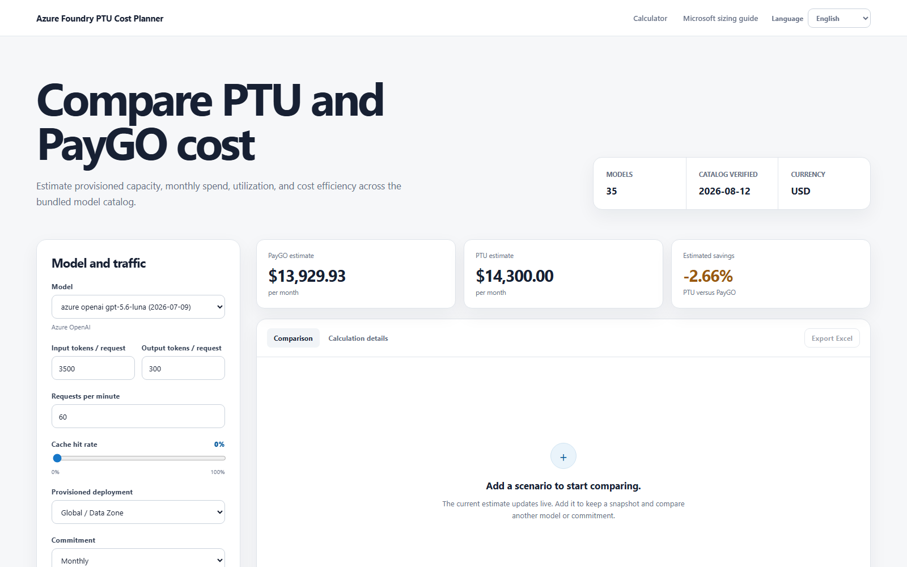

# Azure Foundry PTU Cost Planner

A React and TypeScript calculator for comparing monthly PayGO and provisioned throughput costs. The interface is a responsive Vite single-page application with no Streamlit or Python runtime. A live configuration optimizer recommends the lowest-cost commitment and deployment option for the selected model and charts PayGO against each PTU cost curve as traffic changes.

The bundled catalog includes Azure OpenAI, Azure-sold Llama, and Fireworks on Microsoft Foundry models. Documented token weights drive automatic PTU sizing. Existing Fireworks automatic weights remain labeled assumptions; newly listed Fireworks models require benchmarked capacity because Microsoft does not publish their output weights. Each saved comparison includes a calculation trace. The interface supports English and Simplified Chinese, with English displayed by default.

## UI preview

The main page opens directly on the workload calculator and live cost estimates, without an introductory banner or catalog-summary card.



## Development

```bash
npm install
npm run dev
```

Open `http://localhost:5173`.

## Validation

```bash
npm run typecheck
npm test
npm run build
```

## Container

```bash
docker build -t ptu-cost-planner .
docker run --rm -p 8501:80 ptu-cost-planner
```

Open `http://localhost:8501`.

## Catalog

Pricing and throughput metadata remains in `model_config.json`. The in-app catalog editor validates updates and stores them in the browser's local storage. Restoring the bundled catalog clears that local override.

### GPT-image-2 and GPT-image-2.5 PTU sizing

Select `azure openai gpt-image-2.5-flare (2026-09-08)`, the model identity in the
[official image-model sizing guide](https://learn.microsoft.com/en-us/azure/foundry/openai/how-to/provisioned-throughput-sizing#estimate-ptus-for-image-model),
rechecked on 2026-11-11. It shares the existing `gpt-image-2` calculation.
Enter separate average text input, image input, and image output tokens per request.
All image-model inputs are treated as uncached:

```text
Normalized TPM = RPM x (text input + 1.6 x image input + 3.75 x 1.6 x image output)
Raw PTUs = Normalized TPM / 1,200
Deployable PTUs = max(100, ceil(Raw PTUs / 100) x 100)
```

The 100-PTU minimum and increment apply to Global, Data Zone, and Regional deployments.
The official example (10 RPM, 2,000 text input, 1,229 image input, and 7,024 image
output tokens) produces 461,104 normalized TPM, about 384.25 raw PTUs, and 400
deployable PTUs. The cache slider is unavailable for image models, and inherited
cache settings do not reduce capacity or PayGO estimates. [OpenAI's cached-input
pricing](https://developers.openai.com/api/docs/guides/image-generation#cached-input-pricing)
does not apply to direct Images API calls. This calculator does not model
Responses image-tool caching or the additional orchestrating model's token cost;
OpenAI pricing eligibility does not establish Azure image-PTU cache behavior.

Both models' **Global Standard USD** prices were independently verified on
2026-11-11 using the [Azure Retail Prices API](https://prices.azure.com/api/retail/prices),
East US 2, and their separate `Image 2` / `Image-2.5-flare` token meters: **$5/M text input,
$1.25/M cached text, $8/M image input, and $30/M image output**.
The catalog converts those prices to USD per 1,000 tokens; no prices are inferred
from another model. Cached rates are retained as reference meters, not applied
to these estimates. A workload of 3,500 text input and 300 image output tokens,
60 RPM, no image input, and no text cache hits costs **$69,649.63/month PayGO**
using the calculator's existing 30.42-day month. PTU commitment rates remain
planning assumptions, and the PayGO comparison uses the stated Global Standard scope.
That benchmark is independent of the selected PTU deployment: it is not a matching
Data Zone or Regional quote. For example, verified GPT-image-2 Data Zone Standard
rates are 10% higher than its Global Standard rates.

Use model-specific API usage: text input comes from
`usage.input_tokens_details.text_tokens`, image input from
`usage.input_tokens_details.image_tokens`, and image output from the image output
usage (`usage.output_tokens` for image-only responses). Do not enter aggregate
`usage.input_tokens` as text and add image tokens again. Counts must total the
entire request, including every generated image and charged partial preview.
The common output default is not an image size/quality estimate. Equal PTU weights
and token rates do not imply equal tokens or cost per image across models.
OpenAI's [vision calculator](https://developers.openai.com/api/docs/guides/images-vision#gpt-image-model-inputs)
excludes GPT Image generation/editing; use actual usage instead of legacy vision
tile rules or another image model's token table.

PTU sizing uses peak RPM, but PayGO assumes that RPM continuously for 30.42 days.
The comparison therefore assumes peak and sustained traffic are equal; bursty
workloads require a separate monthly-volume assessment.

Browser-saved custom catalogs are preserved. If an older saved catalog is missing
Flare or still contains its previous unverified prices, update that model's entry
or restore the bundled catalog in the catalog editor.

### Weekly GitHub-hosted documentation updates

**Weekly PTU documentation update** runs on GitHub-hosted Ubuntu every Monday at
01:17 UTC (09:17 UTC+8), with manual runs available in the repository's Actions tab.
It monitors the [main PTU sizing guide](https://learn.microsoft.com/en-us/azure/foundry/openai/how-to/provisioned-throughput-sizing)
and [Fireworks catalog](https://learn.microsoft.com/en-us/azure/foundry/how-to/fireworks/fireworks-model-catalog)
independently. Nothing needs to run on a laptop.

The first run creates a draft baseline PR. Subsequent content changes create a draft
update PR and start GitHub Copilot cloud agent on that same branch. Copilot reviews
model/configuration/calculation changes under `.github/ptu-docs-agent.md`. Unchanged
documents do not start an agent. A matching existing or rejected PR is not resubmitted
automatically; the manual `force_review` option explicitly authorizes another attempt.
Fetch/parser failures preserve the accepted baseline and raise an alert, rather than
removing models.

Versioned `.github/ptu-docs/*.json` snapshots retain published model facts, formulas
and section hashes, including hashes of prose/footnotes; article metadata and line-ending
noise do not trigger updates. Source URLs provide attribution. Snapshots become the
accepted baseline only after the PR is merged.

Copilot completion triggers independent GitHub-hosted automation tests, application
tests and a TypeScript/production build against the exact PR head. Passing validation
marks the PR ready for human review. The monitor and validator never merge or
deploy it and do not use Azure credentials. After the owner merges, the separate
deployment workflow below can update the existing Container App.

For unattended completion, enable Copilot-triggered Actions in repository
**Settings > Copilot > Cloud agent > Policies** by turning off **Require approval
for workflow runs**. Otherwise GitHub pauses downstream workflows until the owner
approves them. This setting allows unreviewed Copilot changes to run Actions:
keep validation read-only, keep privileged reporting on trusted `master`, and
review workflow changes carefully. See [GitHub's workflow approval guidance](https://docs.github.com/en/copilot/how-tos/use-copilot-agents/cloud-agent/configuring-agent-settings#allowing-github-actions-workflows-to-run-automatically-when-copilot-pushes).
Native cloud-agent PR commits retain GitHub's signed Copilot attribution;
snapshot commits use guming3d. Squash-merge manually as guming3d and remove
Copilot trailers if owner-only attribution is required on `master`.

Repository setup requires an Actions secret named `PTU_COPILOT_AGENT_TOKEN`: a
fine-grained user PAT scoped to this repository with **Agent tasks: read/write**.
The cloud task API is preview and its documented start endpoint requires a Copilot
Business/Enterprise subscription. Expired/unauthorized tokens produce an alert.
Never commit the token or an email address.

Each check, failure, Copilot completion and validation result is posted to the
**Weekly PTU documentation updates and alerts** issue with an owner mention and
run/PR links. Enable email for participating/watching notifications at
<https://github.com/settings/notifications>, choose a verified notification address,
and enable Actions email without the failed-only restriction. GitHub sends the emails;
no SMTP password or email-service credential is needed. Native Actions failure emails
also cover failures before the scripted reporter can run.

Use `dry_run` to check without a PR/agent, or `test_failure` to verify failure alerts.
GitHub schedules are best-effort, and public-repository schedules can be disabled
after 60 days without activity; inspect the Actions tab if a weekly result is missing.
No workflow can email about its own run being omitted or disabled by GitHub.

### Automatic deployment after an owner-reviewed merge

**Deploy PTU cost planner** runs entirely on GitHub when `guming3d` merges a PR
into `master`, including weekly documentation PRs. The merge is the production
approval: merely approving, opening or closing an unmerged PR does not deploy.
Direct pushes and merges by other actors do not deploy.

The workflow resolves the exact merged commit and refuses stale commits after
`master` moves. It runs the automation tests, all application tests, TypeScript
and production build, then builds and smoke-tests the Docker image without Azure
credentials. A separate Azure job downloads that tested image, publishes a unique
tag, and updates the existing app using its immutable digest. Only the image and
revision suffix change; ingress, networking, scaling, environment variables,
secrets, registry configuration and managed identity are preserved and checked.
The new revision must become ready and serve the tested HTML/JavaScript/CSS, and
`/health` must pass. Deployments are serialized rather than cancelling an update
partway through.

Passwordless Azure login uses the `container-app-production` GitHub environment,
restricted to `master`, with these environment-scoped settings:

| Kind | Names |
| --- | --- |
| Secrets | `PTU_DEPLOY_AZURE_CLIENT_ID`, `PTU_DEPLOY_AZURE_TENANT_ID`, `PTU_DEPLOY_AZURE_SUBSCRIPTION_ID` |
| Variables | `AZURE_RESOURCE_GROUP`, `AZURE_CONTAINER_APP`, `AZURE_CONTAINER_NAME`, `AZURE_CONTAINER_REGISTRY`, `AZURE_IMAGE_REPOSITORY` |

The dedicated identity trusts only
`repo:guming3d/ptu_cost_compare_tool:environment:container-app-production`.
It has `Contributor` on the existing app only and `AcrPush` plus `Reader` on its
registry only, not subscription/resource-group-wide deployment permissions.
The app's own managed identity retains its existing `AcrPull` assignment.
No Azure password, registry admin key, or laptop process is required.

Deployment outcomes use the same owner-mentioned email/status issue as weekly
checks; native Actions failure email remains the fallback. The run summary and
deployment report retain the previous image digest for manual rollback. A failed
health check is an alert, not an automatic rollback; inspect the revision before
retrying or restoring the previous image. Do not edit app settings concurrently
with a release.

For commissioning, open **Actions > Deploy PTU cost planner > Run workflow** on
`master`, keep `dry_run` enabled, and leave `pr_number` empty. This checks the
build, image, Azure federation, resource configuration, registry read access and
deployment permissions without pushing an image or modifying the app. A real
manual retry requires `dry_run` disabled and the number of an already
owner-merged PR whose merge commit is still the current `master` tip. If newer
commits exist, review and merge the newest PR instead. No unmerged PR can be
deployed using the manual trigger.

### Official-document refresh (October 28, 2026)

The catalog now contains **67 models**, including all **39 exact Fireworks PTU identities** in the [Fireworks catalog](https://learn.microsoft.com/en-us/azure/foundry/how-to/fireworks/fireworks-model-catalog) and the models in the [main sizing guide](https://learn.microsoft.com/en-us/azure/foundry/openai/how-to/provisioned-throughput-sizing). This refresh supersedes the older sizing snapshots below.

Added `gpt-image-2.5-flare (2026-09-08)`, Azure-sold `Llama-3.3-70B-Instruct`, and the missing Fireworks PTU models. Removed native Gemini 1.5 Pro/Flash and Fireworks MiniMax M2.5 because the reviewed documents do not list them. Removed retired PayGO-only DeepSeek V4 Flash 0731 and added the separately documented `FW-DeepSeek-V4-Flash`; no identity mapping between them is assumed. PayGO-only GLM 5.2 Fast and GLM 5.3 Flash are excluded because no PTU parameters are listed.

Updated the ten changed Fireworks minimums, increments, and TPM capacities. GLM 5.3 exposes **Global (5 / 1 / 1,645)**, **Data Zone (320 / 160 / 1,050)**, and the footnote's **Global standard capacity (320 / 160 / 1,050)**, ordered as minimum / increment / input TPM per PTU. New Fireworks entries require an explicitly entered positive benchmark estimate; switching deployment clears that estimate. Their optimizer compares monthly/yearly commitments for the selected deployment only, avoiding reuse of a benchmark across different capacities. Existing automatic Fireworks estimates and overrides remain available.

PTU support is independent of PayGO retirement. Retired PayGO or unverified applicable token prices display **N/A** for PayGO, savings, and break-even in calculations, charts, comparisons, and exports; historical rates never become current savings. `null` catalog prices mean unverified, not zero. Each new verified price records its deployment scope. Global versus Data Zone GLM 5.3 prices are applied separately and charted separately when automatic sizing is configured with a user-supplied output weight.

East US 2 USD retail meters were verified through the [Azure Retail Prices API](https://prices.azure.com/api/retail/prices) for DeepSeek V4.1 Flash, GLM 5.3, Kimi K3, Nemotron 3 Ultra, Nemotron Lightning 3.5, and Azure Llama. Llama's published **4:1 PTU output weight** is independent of its 1:1 Global PayGO price ratio; cached-input prices were not verified, so comparisons using cache hits are N/A. Flare reuses image-2 **sizing**, not its prices: 1,200 text TPM/PTU, 750 image TPM/PTU, image-input weight 1.6, output weight 6, and 100-PTU minimum/increment. Flare-specific Global Standard PayGO meters were subsequently verified on 2026-11-09 as detailed above. Other existing Azure OpenAI rates are retained, not newly repriced.

Provisioned prompts above **128,000 tokens** are rejected for GPT-5.4 and GPT-4.1/mini/nano, before deducting cached tokens; supported image-input tokens count toward this limit. Spillover routing is outside this calculator. PTU commitment prices remain **planning assumptions** ($260/month or $221/month annual equivalent), not current model-specific quotes.

Browser-saved custom catalogs are preserved and show an older-catalog notice. Use **Restore bundled catalog** to adopt the refreshed model list and configurations.

GPT-5.4-mini (`2026-03-17`) uses an explicitly requested **8:1 PTU output-to-input ratio override**, rather than the 6:1 ratio in Microsoft's sizing guide. Token prices, cached-input treatment, and deployment increments are unchanged. For 14,001 input tokens, 79 output tokens, 7,350 RPM, and a 97% cache-hit rate, this gives **978.79 raw PTUs**, rounded to **980 Global / Data Zone PTUs** or **1,000 Regional PTUs**. The override does not establish why the portal screenshot reports 978.00 raw PTUs.

### DeepSeek V4.1 Flash (October 20, 2026)

`fireworks DeepSeek V4.1 Flash` (`FW-DeepSeek-V4.1-Flash`) uses the supplied sizing-table screenshot: **5 PTUs minimum**, **1-PTU increments**, and **11,000 input TPM per PTU**. It is **Global Provisioned only**, with no Data Zone support. The calculator, optimizer, saved comparisons, and exports identify its deployment as Global.

User-supplied PayGO prices are **$0.375/M input**, **$0.008/M cached input**, and **$1.50/M output**. PTU pricing retains the catalog assumptions of $260 per PTU/month for monthly commitment or $221 per PTU/month for annual commitment; these are not new model-specific reservation quotes.

Automatic sizing reuses the existing DeepSeek **4:1 estimated output weight**, not a published Fireworks PTU weight: `normalized TPM = RPM x (input tokens x (1 - cache hit rate / 100) + 4 x output tokens)`. Raw PTUs are normalized TPM divided by 11,000; deployed PTUs are `max(5, ceil(raw PTUs))`. For 3,500 input tokens, 300 output tokens, 60 RPM, and a 10% cache-hit rate, this gives **261,000 normalized TPM**, **23.7273 raw PTUs**, and **24 deployed PTUs** ($6,240/month or $5,304/month with annual commitment). A benchmarked PTU override remains available.

Existing DeepSeek entries and the catalog-wide verification date are unchanged. Browser-saved catalogs are preserved; use **Restore bundled catalog** to load the new entry if a saved override is active.

### GPT-6 normalized token accounting (October 15, 2026)

`gpt-6.1-sol (2026-09-29)` and `gpt-6-sol (2026-09-22)` use the current [Microsoft sizing guide](https://learn.microsoft.com/en-us/azure/foundry/openai/how-to/provisioned-throughput-sizing#normalized-token-pricing-for-gpt-6-astra-and-newer-models). Both provide **3,000 normalized TPM per PTU**, with a Global / Data Zone minimum of 15 PTUs and increment of 5, or a Regional minimum and increment of 50. The published latency targets are 99% > 50 TPS for GPT-6.1 Sol and 99% > 80 TPS for GPT-6 Sol.

Select the applicable context tier explicitly. Each input token belongs to exactly one bucket: uncached, cache read, or cache write. Weights below are ordered as uncached input / cached input / cache write / output.

For GPT-6 models with cache-write pricing, cache write tokens per request default to `input tokens x (1 - cache hit rate / 100)` and update automatically as the input count or cache-hit rate changes. For example, 3,500 input tokens at a 90% cache-hit rate generate 350 cache writes. Editing the cache-write field overrides the estimate and keeps that value fixed until **Use automatic cache writes** is selected. Manual reads plus writes must still fit within the total input count. The same value feeds the live estimate, optimizer, saved comparisons, calculation details, and Excel export; other models retain their existing caching behavior.

| Model | Short-context PTU weights | Long-context PTU weights |
| --- | --- | --- |
| GPT-6.1 Sol | 1 / 0.05 / 1.25 / 5 | 2 / 0.1 / 2.5 / 7.5 |
| GPT-6 Sol | 1 / 0.1 / 1.25 / 5 | 2 / 0.2 / 2.5 / 7.5 |
| GPT-6 Astra | 1 / 0.1 / 1.25 / 5 | 2 / 0.2 / 2.5 / 7.5 |

**Weight = token-category price / the model's short-context input price**, including for long-context requests. Short-context cache reads therefore count as 10% for GPT-6 Sol/Astra or 5% for GPT-6.1 Sol; writes count as 125%. Long-context reads count as 20% or 10%, writes as 250%, and output as 750%. The current guide no longer lists the old GPT-6.1 short-cache 0.1 and Astra long-output 10 exceptions, so the bundled catalog now uses 0.05 and 7.5 respectively.

The right-hand live normalization panel visualizes the disjoint input buckets, each category's token count and weight, its normalized contribution, and the full conversion from weighted tokens per request through RPM to raw and rounded PTUs. It uses the same bucket breakdown as the sizing calculation, including manual cache-write overrides and context changes. For GPT-6.1 Sol short context with 3,500 input tokens, 90% cache hit, 350 automatic cache writes, 300 output tokens, and 60 RPM: `(0 x 1 + 3150 x 0.05 + 350 x 1.25 + 300 x 5) x 60 = 125,700 normalized TPM`, or 41.9 raw PTUs and **45 Global / Data Zone PTUs**.

The split-input diagram shows the prompt from left to right: **cache read (green)** at the input prefix, followed by **cache write (red)** and **remaining uncached input (grey)**. Boundary markers follow the actual token counts, including manual cache-write changes. Each category uses the exact same fill color in the diagram, legend, and normalized-contribution table, in both light and dark themes; the visual ordering does not change PTU or cost calculations.

Browser-saved catalogs are preserved. If their configured weights differ from their price ratios, the panel warns that an old override may be in use; **Restore bundled catalog** loads the updated defaults without silently replacing intentional custom weights.

| Model / tier | Input / 1M | Cached input / 1M | Cache write / 1M | Output / 1M |
| --- | --- | --- | --- | --- |
| GPT-6.1 Sol short | $2 | $0.10 | $2.50 | $10 |
| GPT-6.1 Sol long | $4 | $0.20 | $5 | $15 |
| GPT-6 Sol short | $2 | $0.20 | $2.50 | $10 |
| GPT-6 Sol long | $4 | $0.40 | $5 | $15 |

Token prices retain the October 3, 2026 catalog values; normalized weights were checked against the guide on October 15, 2026. PTU reservation prices retain the existing catalog assumptions ($260 monthly or $221/month annual equivalent). Non-GPT-6 model entries and the catalog-wide verification date are unchanged; the three GPT-6 entries carry their own verification notes.

### September model configurations

The September 11, 2026 [Microsoft sizing guide](https://learn.microsoft.com/en-us/azure/foundry/openai/how-to/provisioned-throughput-sizing) adds the following model-specific configurations. Other model configurations and the catalog-wide verification date remain unchanged; the new entries carry their own source notes.

| Model | Normalized TPM / PTU | Global / Data Zone minimum / increment | Regional minimum / increment |
| --- | --- | --- | --- |
| `gpt-6-astra (2026-09-03)` | 600 | 15 / 5 | 50 / 50 |
| `gpt-image-2 (2026-04-21)` | 1,200 | 100 / 100 | 100 / 100 |

For Astra, select the applicable short- or long-context pricing tier explicitly; the supplied guide does not specify a context-length cutoff. Input tokens include uncached input, cache reads (the cache-hit percentage), and cache writes (the separate token count). The October 15 review refreshes the September snapshot to the current guide's weights shown above, including **7.5** for long-context output. PayGO long-context output remains $75 per million tokens. Existing non-GPT-6 models retain their prior caching behavior.

For GPT-image-2, enter image input and output **token counts**, obtained from API usage or the [input](https://developers.openai.com/api/docs/guides/images-vision#image-input-cost-calculator) and [output](https://developers.openai.com/api/docs/guides/image-generation#gpt-image-25-and-gpt-image-2-output-tokens) token calculators. Normalized TPM is `RPM x (uncached text input + image input x 1.6 + image output x 3.75 x 1.6)`. Image input caching is not modeled; the cache-hit control applies only to text. The guide's example (10 RPM, 2,000 text input, 1,229 image input, 7,024 image output) requires 384.25 raw PTUs and **400 deployed PTUs**.

Astra token prices come from the supplied guide. GPT-image-2 Global Standard prices were checked against the [Azure Retail Prices API](https://prices.azure.com/api/retail/prices) on September 14, 2026: $5/M text input, $1.25/M cached text, $8/M image input, and $30/M image output. PTU reservation pricing uses the existing catalog assumptions ($260 monthly or $221/month annual equivalent). The calculator retains its 30.42-day billing month, rather than the 30-day month used in the guide's illustrative Astra cost comparison.

The calculator is an estimate. Azure pricing can vary by geography, deployment type, currency, and commercial agreement.
