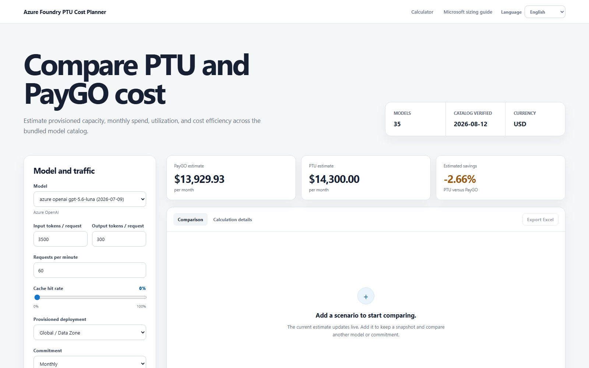

# Azure Foundry PTU Cost Planner

A React and TypeScript calculator for comparing monthly PayGO and provisioned throughput costs. The interface is a responsive Vite single-page application with no Streamlit or Python runtime. A live configuration optimizer recommends the lowest-cost commitment and deployment option for the selected model and charts PayGO against each PTU cost curve as traffic changes.

The bundled catalog includes Azure OpenAI, Fireworks on Microsoft Foundry, and Google models. Azure OpenAI and Fireworks PTUs are estimated automatically with normalized TPM sizing. Microsoft doesn't publish a PTU output-token weight for Fireworks models, so DeepSeek models use a 4:1 ratio, GLM models use 1:1, and other Fireworks models use their PayGO output-to-input price ratio; users can override the Fireworks estimate with a benchmarked PTU value. Each saved comparison includes a complete calculation trace. The interface supports English and Simplified Chinese, with English displayed by default.

## UI preview



## Development

```bash
npm install
npm run dev
```

Open `http://localhost:5173`.

## Validation

```bash
npm run typecheck
npm test
npm run build
```

## Container

```bash
docker build -t ptu-cost-planner .
docker run --rm -p 8501:80 ptu-cost-planner
```

Open `http://localhost:8501`.

## Catalog

Pricing and throughput metadata remains in `model_config.json`. The in-app catalog editor validates updates and stores them in the browser's local storage. Restoring the bundled catalog clears that local override.

GPT-5.4-mini (`2026-03-17`) uses an explicitly requested **8:1 PTU output-to-input ratio override**, rather than the 6:1 ratio in Microsoft's sizing guide. Token prices, cached-input treatment, and deployment increments are unchanged. For 14,001 input tokens, 79 output tokens, 7,350 RPM, and a 97% cache-hit rate, this gives **978.79 raw PTUs**, rounded to **980 Global / Data Zone PTUs** or **1,000 Regional PTUs**. The override does not establish why the portal screenshot reports 978.00 raw PTUs.
### GPT-6 Sol additions (October 3, 2026)

`gpt-6.1-sol (2026-09-29)` and `gpt-6-sol (2026-09-22)` use the current [Microsoft sizing guide](https://learn.microsoft.com/en-us/azure/foundry/openai/how-to/provisioned-throughput-sizing#deployment-parameters-and-throughput-values-by-model). Both provide **3,000 normalized TPM per PTU**, with a Global / Data Zone minimum of 15 PTUs and increment of 5, or a Regional minimum and increment of 50. The published latency target is 99% > 80 TPS.

Select the applicable context tier explicitly. Each input token belongs to exactly one bucket: uncached, cache read, or cache write. Weights below are ordered as uncached input / cached input / cache write / output.

| Model | Short-context PTU weights | Long-context PTU weights |
| --- | --- | --- |
| GPT-6.1 Sol | 1 / 0.1 / 1.25 / 5 | 2 / 0.1 / 2.5 / 7.5 |
| GPT-6 Sol | 1 / 0.1 / 1.25 / 5 | 2 / 0.2 / 2.5 / 7.5 |

**GPT-6.1 Sol's short-context cached-input PTU weight is currently 0.1, not its PayGO price ratio of 0.05**, due to the documented system limitation. Pricing and PTU weights are stored separately so that sizing uses 0.1 while PayGO uses the lower cached-input price.

| Model / tier | Input / 1M | Cached input / 1M | Cache write / 1M | Output / 1M |
| --- | --- | --- | --- | --- |
| GPT-6.1 Sol short | $2 | $0.10 | $2.50 | $10 |
| GPT-6.1 Sol long | $4 | $0.20 | $5 | $15 |
| GPT-6 Sol short | $2 | $0.20 | $2.50 | $10 |
| GPT-6 Sol long | $4 | $0.40 | $5 | $15 |

Prices and weights were checked on October 3, 2026. PTU reservation prices retain the existing catalog assumptions ($260 monthly or $221/month annual equivalent). Existing model entries, including Astra's September snapshot, and the catalog-wide verification date are unchanged; the two new entries carry their own verification notes.

### September model configurations

The September 11, 2026 [Microsoft sizing guide](https://learn.microsoft.com/en-us/azure/foundry/openai/how-to/provisioned-throughput-sizing) adds the following model-specific configurations. Other model configurations and the catalog-wide verification date remain unchanged; the new entries carry their own source notes.

| Model | Normalized TPM / PTU | Global / Data Zone minimum / increment | Regional minimum / increment |
| --- | --- | --- | --- |
| `gpt-6-astra (2026-09-03)` | 600 | 15 / 5 | 50 / 50 |
| `gpt-image-2 (2026-04-21)` | 1,200 | 100 / 100 | 100 / 100 |

For Astra, select the applicable short- or long-context pricing tier explicitly; the supplied guide does not specify a context-length cutoff. Input tokens include uncached input, cache reads (the cache-hit percentage), and cache writes (the separate token count). The retained September 11 snapshot uses short-context PTU weights of 1 / 0.1 / 1.25 / 5 for uncached input / reads / writes / output, and long-context weights of 2 / 0.2 / 2.5 / **10**. This snapshot predates the current guide's 7.5 long-context output weight and is not refreshed by the Sol-only addition. PayGO long-context output is $75 per million tokens. Existing models retain their prior caching behavior.

For GPT-image-2, enter image input and output **token counts**, obtained from API usage or the [input](https://developers.openai.com/api/docs/guides/images-vision#image-input-cost-calculator) and [output](https://developers.openai.com/api/docs/guides/image-generation#gpt-image-25-and-gpt-image-2-output-tokens) token calculators. Normalized TPM is `RPM x (uncached text input + image input x 1.6 + image output x 3.75 x 1.6)`. Image input caching is not modeled; the cache-hit control applies only to text. The guide's example (10 RPM, 2,000 text input, 1,229 image input, 7,024 image output) requires 384.25 raw PTUs and **400 deployed PTUs**.

Astra token prices come from the supplied guide. GPT-image-2 Global Standard prices were checked against the [Azure Retail Prices API](https://prices.azure.com/api/retail/prices) on September 14, 2026: $5/M text input, $1.25/M cached text, $8/M image input, and $30/M image output. PTU reservation pricing uses the existing catalog assumptions ($260 monthly or $221/month annual equivalent). The calculator retains its 30.42-day billing month, rather than the 30-day month used in the guide's illustrative Astra cost comparison.

The calculator is an estimate. Azure pricing can vary by geography, deployment type, currency, and commercial agreement.
